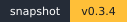
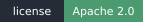
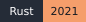
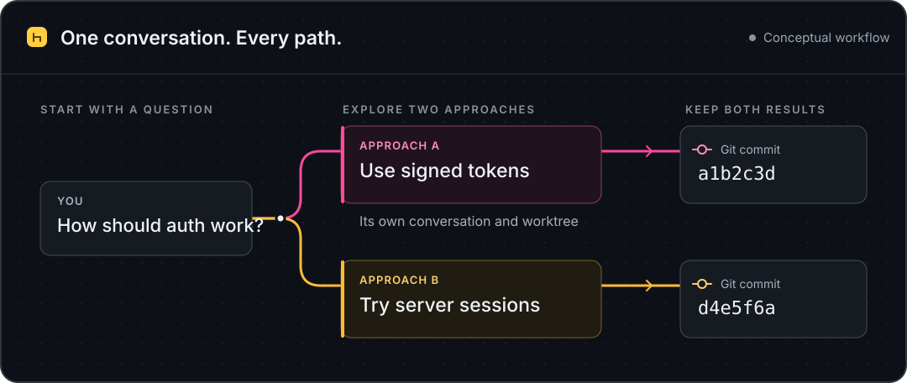

<p align="center">
  
</p>

<h1 align="center">Agentree</h1>

<p align="center">
  <strong>Version control for AI agent conversations.</strong>
</p>

<p align="center">
  Branch your thinking. Run agents in isolated worktrees. Keep the code and the conversation connected.
</p>

<p align="center">
  <strong>Codex · Claude · OpenCode</strong><br />
  <sub>Desktop app · Local-first · macOS Apple Silicon &amp; Linux x86_64</sub>
</p>

<p align="center">
  <a href="https://agentree.app"></a>
  <a href="#project-status"></a>
  <a href="#quick-start"></a>
  <a href="LICENSE"></a>
</p>

<p align="center">
  <a href="tauri-app/src-tauri/Cargo.toml"></a>
  <a href="tauri-app/package.json"></a>
  <a href="tauri-app/package.json"></a>
  <a href="tauri-app/src-tauri/Cargo.toml"></a>
</p>

<p align="center">
  <a href="https://agentree.app">Website</a> ·
  <a href="#why-agentree">Why Agentree</a> ·
  <a href="#quick-start">Quick start</a> ·
  <a href="#development">Development</a> ·
  <a href="#contributing">Contributing</a>
</p>

<p align="center">
  <picture>
    <source media="(max-width: 600px)" srcset="docs/assets/conversation-tree-mobile.svg" />
    
  </picture>
</p>

## Why Agentree?

Good ideas rarely follow a straight line. You try an approach, discover a constraint, and want to explore another direction. A single chat thread makes it hard to keep both paths useful.

Agentree gives those paths a home. Start from an earlier turn, explore a new branch, and return to your previous work with its conversation and code history together.

| Feature | What you can do |
| :--- | :--- |
| **Branch from any turn** | Try a different prompt or approach while preserving the path you came from. |
| **Run work in parallel** | Give agent runs their own Git worktrees so separate approaches have separate working directories. |
| **Connect conversation and code** | See which conversation produced a commit, then inspect the changes. |
| **Choose your agent** | Configure Codex, Claude, or OpenCode with your own provider accounts. |
| **Follow the work** | Inspect streamed agent activity, tool calls, file changes, and output artifacts. |
| **Keep local history** | Store workspace and conversation state locally, with cloud features configured separately. |

### Two histories, one workspace

**Conversation history** records what each message replies to. **Git history** records the code state an agent started from and the commit it produced. Agentree keeps both visible, so you can follow an idea and inspect its implementation.

## Quick start

This source snapshot targets **macOS Apple Silicon** and **Linux x86_64**.

Before you begin, install:

- **Node.js 24** and **pnpm 11.15.1**. The exact Node version is in [`.node-version`](.node-version).
- **Rust** and the [Tauri 2 platform prerequisites](https://v2.tauri.app/start/prerequisites/).
- **Git**, for repository and worktree operations.

From the repository root:

```sh
cd tauri-app
pnpm install --frozen-lockfile
VITE_DEV_AUTH_BYPASS=true pnpm run dev
```

This starts the desktop development app without requiring an Agentree Cloud account. The first native build can take a few minutes.

1. **Set up a provider.** Follow onboarding to add your own Codex, Claude, or OpenCode account.
2. **Connect a repository.** Select a local Git repository as your workspace.
3. **Start a conversation.** Send a task and follow the agent's activity and resulting code changes.
4. **Explore another path.** Branch from a relevant turn when you want to try a different approach.

Provider runtimes are downloaded when needed using the pinned [runtime manifest](tauri-app/runtime-manifest.json). Provider access requires your own account or API credentials.

> The authentication bypass is for local development. Unset `VITE_DEV_AUTH_BYPASS` before a production build; the build configuration rejects production builds with it enabled.

<details>
<summary>Already have Agentree installed?</summary>

This snapshot retains the original app identifiers. Running it on the same machine can use an existing Agentree installation's app data. For a separate development installation, change the identifiers in [the base Tauri configuration](tauri-app/src-tauri/tauri.conf.json) and [the development configuration](tauri-app/src-tauri/tauri.dev.conf.json), or use a separate OS account.

</details>

## Development

Run these commands from `tauri-app/`:

| Command | Purpose |
| :--- | :--- |
| `pnpm run dev` | Launch the Tauri desktop app. |
| `pnpm run dev:web` | Start the frontend in a browser; native features require Tauri. |
| `pnpm run build` | Type-check and build the frontend. |
| `pnpm run tauri:build:prod` | Build a desktop package. |
| `pnpm run test:ci` | Run frontend, runtime archive, contract, and deterministic performance checks. |
| `pnpm run test:rust` | Run native Rust tests. |
| `pnpm run bindings:tauri` | Regenerate TypeScript bindings after native command or type changes. |

### Project structure

```text
tauri-app/
├── src/                 React interface and application logic
├── src-tauri/           Rust backend, Git operations, and agent runtime
├── runtime-packages/    Provider runtime dependency manifests
├── scripts/             Development, build, and validation tools
└── tests/               Desktop and performance test harnesses
shared/                  Shared agent-status contract
```

The interface uses React and TypeScript, the desktop shell uses Tauri and Rust, and local application state is stored in SQLite. Coding agents run through provider adapters in managed Git worktrees.

## Project status

This is a **development source snapshot**, based on commit `d9acc68c`, version `0.3.4`.

The Git history is a [curated reconstruction](docs/history.md) of 50 app milestones, arranged across August–October 2026, followed by a present-day publication commit. Public timestamps were adjusted for this reconstruction; original source dates are preserved in the provenance notes and commit metadata.

The desktop app, its tests, and its build tooling are included. Cloud sign-in, public sharing, analytics, and signed updates need separate service configuration; the cloud server and public-sharing websites are outside this repository.

The export passed the frontend production build, **1,110 frontend tests**, and **65 runtime and adapter tests**. Native compilation and desktop end-to-end checks were not run for this export. See [the export notes](EXPORT.md) for the exact scope, source adjustments, and validation details.

## Contributing

Bug reports, focused fixes, and documentation improvements are welcome. For a useful bug report, include your operating system, provider, reproduction steps, and expected behavior. Remove account details, tokens, and private repository content from logs and screenshots.

Keep changes focused and run the checks relevant to your change. Use pnpm and preserve the committed lockfiles. When changing native commands or types, regenerate the frontend bindings too.

## License

Agentree is licensed under the [Apache License, Version 2.0](LICENSE).

Vendored dependencies retain their own terms. See [third-party notices](THIRD_PARTY_NOTICES.md).
